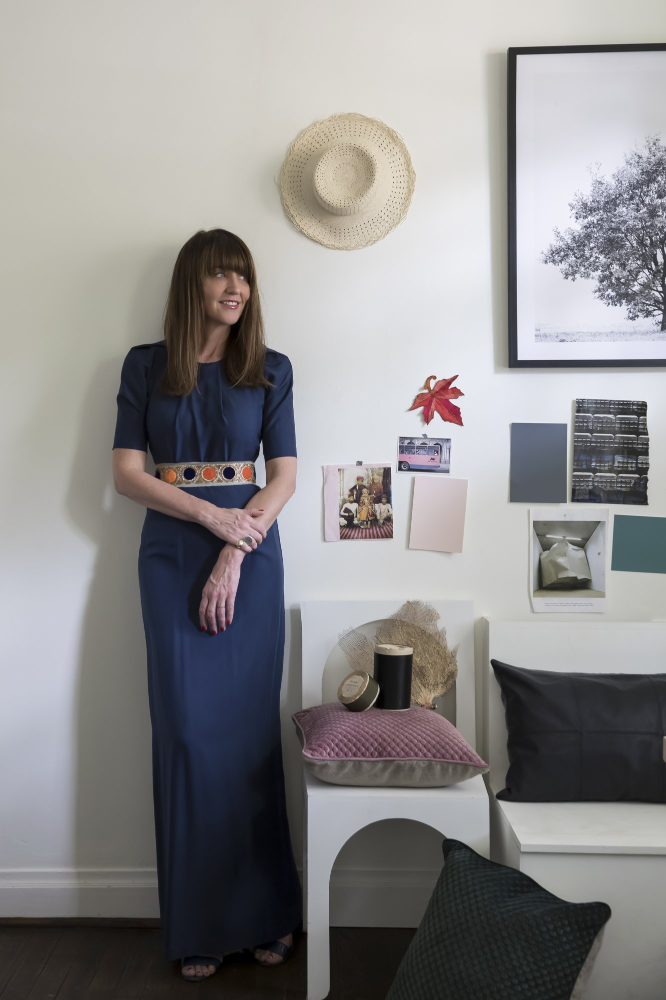
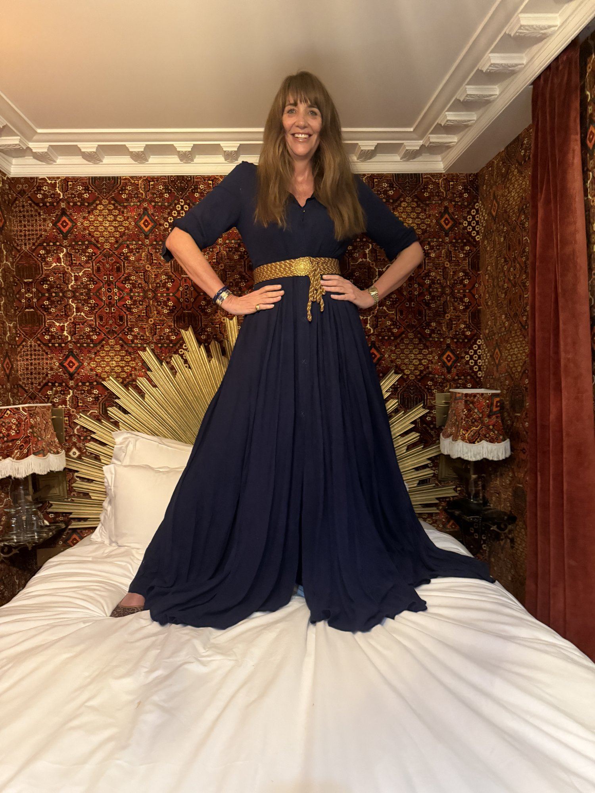

> *Ed's note: We first visited Megan Morton at home in 2017. In 2026 she sent us an update, so her new words come first, with our original conversation below.*

## Megan Morton in 2026

<Caption>Megan, at home</Caption>

Known as the House Whisperer, the home stylist now describes herself simply as an adventuress.

<PullQuote>The more you know, the less you need.</PullQuote>

### On work and the creative life

I run with both the creative, ASMR-chasing side and the discipline, maths and restraint that good work needs.

<Caption>Megan</Caption>

### The hardest chapter

Losing my darling father, John, who is now immortalised at www.johndotcom.com.au (launching soon!).

### What she is using now

I love to cleanse with FLUFF oil, then follow with the Dr Kate cleanser (yes, I double cleanse). I love Go-To, and in the evening I use a sandalwood cream for mature skin that I adore. I never go to bed without a face wash, and I adore an apricot body cream that I source in India.

I love all the recommendations from Beauticate, especially the oils. I LOVE face oil.

<Caption>Megan, in India</Caption>

<Caption>Megan, teaching</Caption>

---

## From Our 2017 Conversation

### Beauty, as we well know, has a myriad of meanings and we all experience it in different ways. Some see it, some are it and some, arguably the most lucky ones, get to feel it, express it and make it. [Megan Morton](http://www.meganmorton.com/) is one such woman. Known as the 'House Whisperer' the stylist has worked her magic for the covers of Vanity Fair, Elle Decoration UK, Vogue Living, Inside Out and In Style, countless celebrities and, a testament to character, her next door neighbour. While the home space is her primary canvas to curate beautiful things, she's also a bit of beauty product aficionado, so we were beyond intrigued to go inside her, unsurprisingly, incredible home to chat about her absolutes in the beauty bag, the secret weapon skincare she carries around with her and her endless search for the perfect toothpaste...

## Megan's Creative Inspiration

### “When seeking creative inspiration, I try to be as analogue as possible.

Everything that is available to us is digital and has been done before, I find it \[to be\] a repetitive pool. I like to take inspiration from a heady mix of music, written word, nature and solitude!

### I read once that “routines make beauty” but we all know that happiness does.

In saying that, I love rituals. I am loyal and I live for pampering. This makes me the perfect beauty-buyer. I am time poor, share my bathroom with too many people and am forgetful! This makes me the worst beauty client. I never miss my nail appointment as I love cocktail rings and bangles and nail grooming is part of it. Kester Black is my go to. I love the colours ‘Silver Birch’ (it’s my current go-to) and I recently wore ‘Australian Eucalyptus’ with an all-navy look last week and couldn’t stop putting my hands on my pants and gah’ing, it’s everything. I am a major fan-girl of \[Kester Black founder\] Anna Ross, Telstra Business Woman of the Year and nail polish all-round angel.

## Megan's Skincare Heroes

### I have never liked the feeling of makeup on my face.

I have always loved cold creams, lotions, so I have always taken my makeup off (hence why I invest in so many dark grey face cloths!). The best feeling topically on my skin is Santa Maria Novella Crema Idralia, I have only praise for this wonder cold cream. I also love their Nourishing Night Oil.  Trust me, this is the absolute bomb – the night creams of all night creams. [Ren Glycolactic Renewal Radiance Mask](http://www.mecca.com.au/ren/glycol-lactic-radiance-renewal-mask/V-000905.html) is a favourite of mine too, I am sure it should cost more, but I get to this wonder mask about once every fortnight and love the aftermath. I always keep Santa Maria Novella Olio Di Mandorle Dolci sweet almond oil on me I would drink this if I didn’t love it on my face as much as I do. I keep it in my bag and dab away. When I’m flying I apply with cotton pads regularly during flight. It’s pure and heavenly with not one nasty ingredient added. I like [Dr Dennis Gross Extra Strength Daily Peels](http://www.mecca.com.au/dr-dennis-gross/alpha-beta-extra-strength-daily-peel/V-017009.html). Literally 2 minutes is all it takes to get a seriously improved skin tone. After a long haul flight it’s the first thing I put on.

## Megan's Express Makeup Routine

### My makeup routine is an express, race-out-the-door aim…

… I clean my face, apply a dab of blush, a glossy lip and mascara. If there is 40 seconds spare, I curl my lashes but otherwise it’s a four minute turn-around for my work day. In winter I love to wear blush, my favourite is [By Terry Blush Glacé in Frozen Petal](http://www.mecca.com.au/by-terry/blush-glace/V-018659.html). I don’t wear foundation so this is perfect on my bare skin. I wear Nars Velvet Matte Lip Pencil in Cruella – it’s the perfect blue-based red. If I’m going to wear a red lip, I like to liner first, it’s polished and that’s what wearing a red lip is all about. I lather my lips (and anyone else’s who will let me!) in [Omoravicza’s Perfecting Lip balm](http://www.mecca.com.au/omorovicza/perfecting-lip-balm/I-026269.html).  I am to the point of religious with this. As I age I care more about how my body and face feels that how it looks and this is the perfect lip remedy.

## Megan's Body Care Philosophy

### Body care is really important to me.

Because I’m not a ‘makeup’ person who likes obvious effort, I do love what I call ‘invisible self care!’. Things that make me feel amazing that only I can feel and see. I use Dr. Bronner Pure Castile Soap on my body (I also clean my makeup brushes with this). I also go to Barbara Robertson Alexander technique because I appreciate and want perfect posture more than I want perfect skin. I go to [All Saints Clinic](/beauty-style/cosmetic/news-australias-newest-and-most-elite-skin-clinic-opens-its-doors/news-australias-newest-and-most-elite-skin-clinic-opens-its-doors) for massages. I am most concerned with how I feel before how I look.

## Megan's Fragrance Obsessions

### One of my favourite fragrances is, I have to confess, a room spray…

… It’s [APC Fleur D’Oranger](http://usonline.apc.fr/room-sprays-yszaa-m82001#Orange%20blossom) – it’s summer in a bottle, sharp and undeniable. It’s perfect on clothes, especially linen clothes to relax in. For full intoxication, nothing beats the depth and breadth of the Grandiflora Magnolia Sandrine from the Grandiflora fragrance range, Sandrine is my hands down favourite, followed closely by Madagascar Jasmine. I like putting a dab of Kiehl’s musk oil behind my ears and wrists in winter, I find this intoxicating and most of my winter cashmeres smell of this. It’s basically my fragrance just for my knitwear!

### My biggest bugbear is toothpaste.

I’m constantly searching for a 100 per cent organic one. Until then I am happy with Dr Bronner’s fluoride free 70 percent organic All-One Toothpaste. I use Anise because licorice is my one of my favourite flavours. And yes, ok ok, it is also a perfect match to my bathroom palette! I joke with my husband that instead of buying shares and bonds I have bought toothpastes. I also can’t live with my tongue scraper. Why don’t we \[more of us\] use them? It’s how Indians keep heir breath so light and lovely. I have early starts so I scrape every morning for mouth hygiene. At first I was weirded out but it’s now a very important step.

## Megan's Meditation Practice

### I meditate. Daily. Nothing more is then needed.

My job is both mental and physical so I need a clarity rich brain.  I also add a drop of pure Indian rose water in my eyes in the morning. Part of my Excursion to India has a rose farm visit and I buy up in bulk from the organic rose dealer. I was a yoga-session-a-day person then I stopped completely. I am ready to go back any day now and hopefully will find the middle ground.  My job is both mental and physical so yoga is a multi purpose-reliable double delivery for me.”

Story by Rikki Hodge-Smith; Photography via Megan Morton
