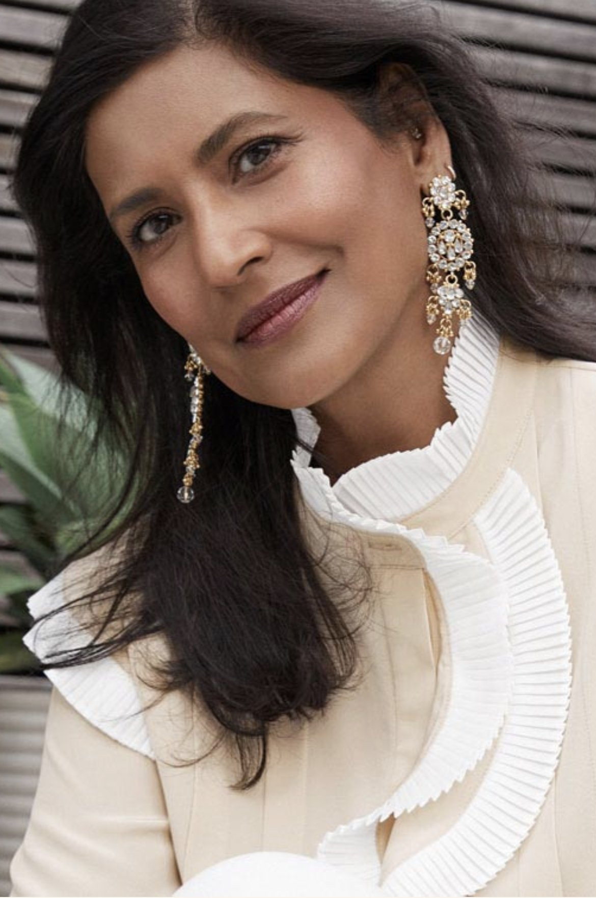
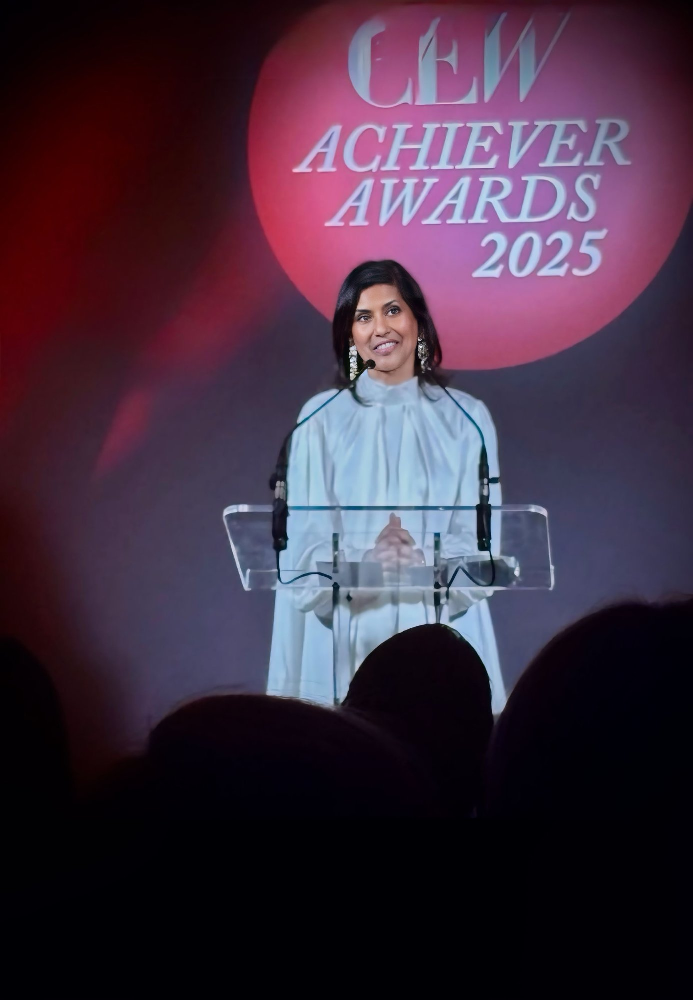
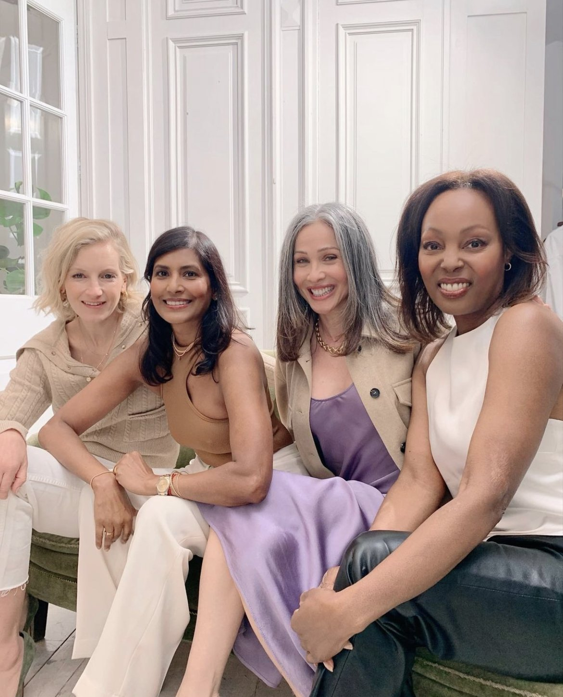
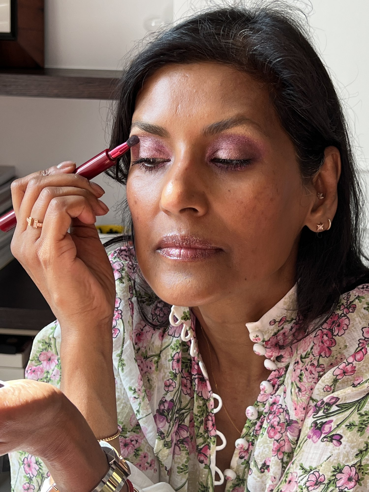
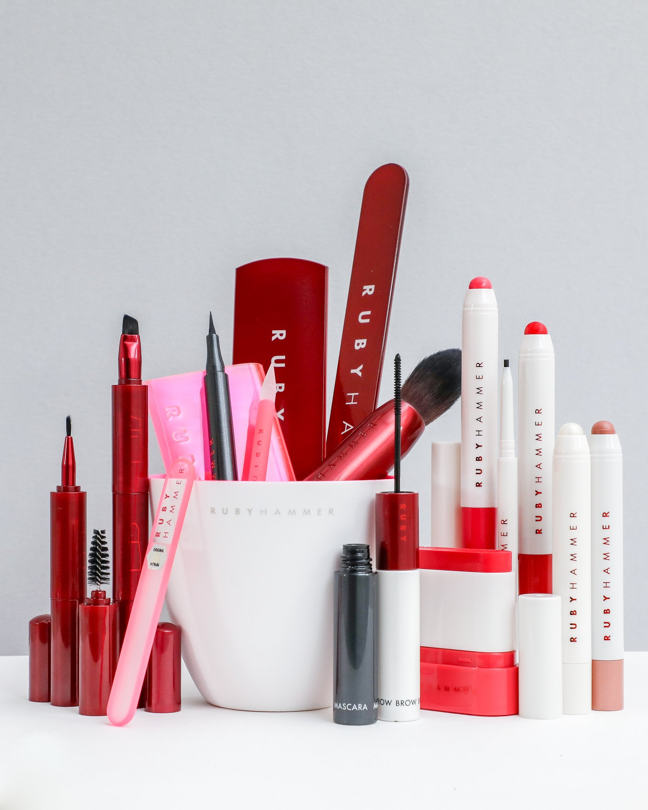

> *Ed's note: We first spoke to Ruby Hammer in 2021. In 2026 she told us what has changed, what hasn't, and what she wants women to know. Her new words come first; our original conversation follows below. You can also read her earlier interview on [diversity in beauty](/interviews/creatives/ruby-hammer-major-brit-makeup-artist-on-the-complexities-of-diversity/ruby-hammer-major-brit-makeup-artist-on-the-complexities-of-diversity).*

## Ruby Hammer in 2026

<Caption>Ruby, 2026</Caption>

Global makeup artist, brand founder and MBE Ruby Hammer has never been shy about the parts of life that people prefer to keep quiet.

<PullQuote>As an artist, I can paint a face and make someone look beautiful on the outside. But as a woman, I know that the most transformative thing you can ever put on is courage.</PullQuote>

True beauty is refusing to hide the messy parts of life, speaking openly about the things people prefer to keep quiet, and helping other women find their own reservoir of bravery.

<Caption>Ruby at the CEW Achiever Awards 2025</Caption>

## Ruby's Earliest Years: Four Languages and a Royal Wedding

I was born and raised in Nigeria until I was twelve, so my earliest years were a real mix of cultures. I had a very African childhood, but at home we were deeply rooted in my family's Asian heritage. It meant I was always learning to navigate different worlds, even before we eventually moved to the West.

The thing that probably shaped me the most was living between such distinct languages. Nigeria had been a British colony, so English was the key to communicating across hundreds of regional dialects. It was so strictly enforced that we were caned at school if we didn't speak it. My daily life was a constant switch: proper English in the classroom, Bengali at home with my parents, and Hausa the minute I stepped outside to go to the local markets. You learn very quickly how to adapt to wherever you happen to be standing.

When we relocated to the UK, the culture shock wasn't about the language at all. It was the pop culture. We hadn't grown up with a television in Africa, so I found myself sitting with my new school friends, completely unable to join their conversations. I remember being desperate to watch the Royal Wedding. It wasn't royalist fervour, I just wanted to go to school the next day and know what everyone was talking about. My dad understood and rented a television just in time. My brothers were thrilled they could finally watch the sport.

That disconnect spilled over into music. I had never heard of the Bay City Rollers, Donny Osmond or David Cassidy. My childhood soundtrack had been James Brown, Marvin Gaye and Motown, mixed with Indian Bollywood music. I knew who The Beatles were, but The Rolling Stones were a complete mystery.

Those years taught me how to read a room, how to observe people, and how to bridge the gap between the traditional world I came from and the completely new one I was trying to figure out.

## The Hardest Chapter: Divorce, and the Reservoir of Courage

Without a doubt, the most challenging period was my divorce. Every other hurdle I had faced, passing exams, university, starting my career, was something I could work through. The divorce completely floored me.

It made me question everything, from my looks to my career. It was a profound betrayal and a deep humiliation. My daughter was eleven and just starting big school, so I had to keep things together for her (not always successfully), but I didn't know who I was anymore.

There was a huge disconnect between my public and private life. Outwardly, I was a successful makeup artist and the launch of the Ruby & Millie brand was pending. My whole job was making other people feel beautiful and telling women to be confident. Inside, I didn't feel it at all. My self-respect had fallen through the floor.

When something strips away your entire identity, it forces you to face yourself. It really is where you have to find that reservoir of being brave. I will be eternally grateful for the unconditional love of my family, friends and colleagues. It was a brutally hard lesson, but it taught me that you can hit absolute rock bottom, lose every ounce of your confidence, and still rebuild your life and your self-worth from scratch.

<Caption>Ruby, with friends</Caption>

## What You Wouldn't Guess About Ruby

How can anyone really know about anybody in their entirety? People might not guess that I have a bit of a poo mouth and I definitely talk too much, but I am totally open where it counts.

Throughout my career I have made a point of speaking up about taboo topics. I was talking about the menopause over a decade ago, long before it was a common conversation. I let everyone know my age, and I share my own struggles with things like hair thinning and being hard of hearing. I truly believe that the moment you speak openly about something, it simply stops being a taboo.

## Ruby's Current Beauty and Wellness Routine

<Caption>Ruby, at home</Caption>

**Eyes first.** I always start by taking off my eye makeup with a biphasic remover from Lancôme, Glossier, Neutrogena or La Roche-Posay. I wore contact lenses for years and really dislike the oily film cleansing balms can leave over the eyes.

**A proper cleanse.** If I've been wearing makeup, I use a heavier balm. Elemis, Eve Lom and Liz Earle are all wonderful, but I have been completely blown away by Seed to Skin. For me this step is deeply grounding. I love warming the balm in my hands and massaging it in from the chest upwards. It feels like a mini facial every single day, and you really see the cumulative results. On a lighter day I prefer a milky cleanser like Curél. If you cleansed thoroughly the night before, there is no need to aggressively do it all again in the morning.

**Serum, eye cream, moisturiser, SPF.** I let my skin dictate the serum, whether that is firming or, as is usually the case for me, tackling pigmentation. I have used an eye cream since my late teens. My friends used to laugh, but I thought it was better to start young than look back and wish I had. My moisturiser changes with the season: heavier in winter, lighter in summer, with niacinamide and hyaluronic acid for specific concerns. I always finish with SPF. Beauty of Joseon makes a brilliant one, so light that I find myself using it much more often.

**Top to toe.** I believe skin should be kept great from top to toe. I use body exfoliators regularly, have facials and massages whenever I can, and train with a personal trainer. I have a weekly manicure and fortnightly pedicures. I speak with my hands a lot, and when my nails look good I instantly feel more confident.

**Supplements.** I take CoQ10, vitamin C, folic acid, a thin aspirin (because I take statins), collagen, Symprove and magnesium. I go through phases of taking them religiously and then stopping, but I always feel the drop-off in my energy and skin, which reminds me to start again. If you take collagen, you must take vitamin C. If you take statins, you need CoQ10. A B complex is next on my list. I also love the chill patches from The Whatsupp Co to help balance my mood.

**Makeup.** I'm a total product whore and use absolutely every brand. If something doesn't work for my face, it goes straight into my professional kit. For my own daily routine my key items are a lip serum balm, a mascara and brow duo, and a cheek colour. As long as I cover those three domains, eyes, lips and cheeks, I always feel pulled together.

<Caption>The Ruby Hammer range</Caption>

## What Ruby Wants Next

I would honestly love more support. Being a quiet activist and running a self-funded brand in this business is incredibly tough, and I think we all need to make a conscious effort to show up for one another. Historically the press was much more open because funding was high, but nowadays it feels as though everything is pay to play, which makes it very difficult for independent voices to be heard. Ultimately I just want to see a more open and honest beauty industry, a space where we genuinely support and champion each other.

---

## From Our 2021 Conversation

There’s really no other way to put it: Ruby Hammer is a dynamo. Having been at the top of her makeup artistry game for three decades, she has worked with every designer and model you could imagine, as well as run two beauty brands bearing her own name (and been awarded an MBE, no less). Behind the scenes, she has weathered tragedies, including divorce and the loss of both of her parents, raised a loving daughter, and put lessons she has learned the hard way into practice in her successful second marriage. Turning 60 this year, Ruby was reflective about the importance of learning from the past while remaining focused on the future, and teaches us what makeup to leave behind and what to never leave the house without as our faces change through the years.

<Caption>IMAGE: INSTAGRAM <a href="https://www.instagram.com/p/CRgnVwJNspy/">@rubyhammer</a></Caption>

_“I gave up trying to be a superwoman ages ago, but I also do my best not to just give in. It is a question of finding balance._

No one is really all one way or the other. There’s trying to be or to present our best selves, and then there’s hiding our real emotions, and feeling like we are not being true to ourselves. Everyone has imposter syndrome at times. It is ok to be vulnerable.

<Caption>IMAGE: INSTAGRAM <a href="https://www.instagram.com/p/CFy3KtoAy0_/">@rubyhammer</a></Caption>

## Ruby’s Makeup Philosophy

_How you do your makeup is an expression of your own sense of aesthetics._

A full face has never been my go-to look, although there’s nothing wrong with it. I think sometimes it comes about because a person is lacking the skills, time, or tools to do something a bit more nuanced, though; for instance, it can seem easier to slather a base on all over and call it a day than just to pinpoint conceal and highlight where it will suit you best. I’d like to suggest that you consider how much more skilful you would become (and how much time you would ultimately save) if you really get to know what works for you and your unique face, though!

Always remember that less is more. Whatever look or element you are going to do, really focus on it. Get the right tools and products and spend the time focused on the effect you are trying to achieve.

<Caption>IMAGE: INSTAGRAM <a href="https://www.instagram.com/p/CNXKs3zAG7s/">@rubyhammer</a></Caption>

_You must_ always _have good lighting. Natural light is the best, but even then, you have to make sure it’s not only coming from above or only coming from one side, which isn’t always possible, so I like the [Riki mirrors](https://rikilovesriki.com/collections/riki-mirrors?gclid=EAIaIQobChMIrZSzhqS08gIVnoNLBR2HqQU7EAAYASAAEgIB3vD_BwE) a lot._

A quick way to amp up your makeup is to bring some more drama to the eyes. I like to add either a touch of glitter or more liner and mascara.

You’ll enjoy experimenting more if you know how to correct things. There are so many simple ways to fix anything! Tidy up with a cotton bud, blend out with translucent powder if you have used too much product, dampen a beauty blender with moisturiser to soften your base and add a glow.

<Caption>IMAGE: INSTAGRAM <a href="https://www.instagram.com/p/CSC3dO-NosF/">@rubyhammer</a></Caption>

## Ruby on Makeup and Ageing

_Remember, you have the skill in your hands to make your face look how you want it to look, and there are basics that, done well, make a face look its best, no matter your age._

For me, it starts with a great brow; you really need that to frame the face. From there, you can choose eyeshadow or not; it really depends how the skin around your eyes and your eyelids has aged. Don’t use eyeshadow at all if you don’t want to, and don’t feel like you need to blend three colours and make it a whole thing if your lid won’t stay up to show it! Liner is essential, though. I work close to the lashes, even tightline, and add a small flick. It’s all about definition.

Get to know yourself as you are now, and stop trying to chase the thing that isn’t achievable. I’m at the end of my menopause now, and know I should be exercising more, but I also know that doing that with the aim to pour myself into skintight clothes is not the answer. Work with what you have. There’s nothing wrong with age.

<Caption>IMAGE: INSTAGRAM <a href="https://www.instagram.com/p/CQQxO8MgMc9/">@rubyhammer</a></Caption>

_I do sometimes reflect on my past, as there have been wonderful times and achievements that I am proud of, and it can be helpful to take stock and to put things in context._

But I am a realist, and know we cannot simply live in the past. Our present is so, so important and the actions I undertake now will set my future, so I take the lessons from my past to guide and help me today and tomorrow.

<Caption>Ruby with Ruby & Millie co-founder Millie Kendall IMAGE: INSTAGRAM <a href="https://www.instagram.com/p/CQdvgIDgxPw/">@rubyhammer</a></Caption>

## Ruby on Loss and Reinvention

_I lost my mum in 2012, when I was 50; it was a very hard time. I had also finished up with my brand, Ruby & Millie, and even though people always want to know what’s next, I didn’t feel the urge to do anything at all, honestly._

I was mourning the loss of my mum, and I suppose I was mourning the end of that part of my career, too. And then I started the menopause, which had a very big effect on my feelings about everything. This was the end of my fertility… was it also the end of my femininity? No, but it did make me weigh up my whole life and existence and made me question what was and wasn’t important. I knew for me that was my family, and I wanted to prioritise having time and energy for them over giving it to a brand again, even if that brand was my own.

<Caption>IMAGE: INSTAGRAM <a href="https://www.instagram.com/p/CQ3Q3MTtsY7/">@rubyhammer</a></Caption>

_Eventually, I remember lying on a beach somewhere, and starting to feel the creative urge, but I didn’t know if I was truly ready to make a go of it again. When I got back home I gave it all some more thought, and when I properly looked about the whole business I realised the world of beauty had changed so much._

Makeup artists like Charlotte Tilbury and Pat McGrath had made their own hugely successful brands. Much as I admire the scale of what Charlotte has done, she is 12 years younger than me, and I didn’t feel like I had the time or gumption to do something like that. A start up needs so much attention, especially at the beginning. I was also aware of how much amazing product and content was out there, and wondered if I wanted to add to the noise and fight for that bit of space. So I sat back and actually considered what I was good at: I know I can do anybody’s face, not just my own, and that it therefore didn’t matter that I didn’t have a million Instagram followers. I thought about what I brought to the table as being another option for someone, and reframed it for myself that what I was offering was ‘as well as’, rather than needing to be ‘instead of’.

<Caption>IMAGE: INSTAGRAM <a href="https://www.instagram.com/p/CQgA6VugkCE/">@rubyhammer</a></Caption>

## Building Ruby Hammer Beauty

_Everything I have learned over my career has been put into [Ruby Hammer Beauty](https://rubyhammer.com/), so much as the line itself is new, its heritage goes back a long way._

Now we have released our first makeup products, an eyeliner pencil and [a liquid liner](https://rubyhammer.com/products/liquid-eyeliner). The pencil is nice and thin, and easy to blend once it’s applied, and it’s retractable. It’s such a bugbear of mine when you push up a good eye pencil and it won’t go back down. I find pencil so easy. I love liquid liner, but I need my glasses and a magnifying mirror to put it on! Applying pencil is that bit easier for those of us whose eyesight has worsened as we get older. I haven’t done a mascara, though, and I won’t ever do one because Lancôme does such excellent ones. How do I compete with the be all and end all? I don’t have to do everything, and don’t see the point in competing on certain products when there’s such good ones out there. I’m looking into doing a lash curler, though, as you can use that and then use any mascara you like. And yes, I am here to tell you that you need a lash curler! It opens up your eye in a very particular way that mascara can’t on its own.

<Caption>IMAGE: INSTAGRAM <a href="https://www.instagram.com/p/CSG5Av1tvye/">@rubyhammer</a></Caption>

_We have to be aware of privilege in the beauty space: if you’re making honest claims of being clean and green, then your products are going to be very expensive to make, and then for the consumer to buy._

For one, properly sustainable packaging is so prohibitive for most brands and consumers, even if the good intention is there. My whole life, I have always wanted the best I can afford in every area, but no one should need a second mortgage to afford excellent beauty products. I mean, the price should reflect the quality, but brands shouldn’t just be fleecing people. There are certain brands up there in the stratosphere where it feels like what you’re really paying for is the story or the history (or, let’s be real, just their profit margin!)

<Caption>IMAGE: INSTAGRAM <a href="https://www.instagram.com/p/CP0ZlN2AI0N/">@rubyhammer</a></Caption>

## Ruby on Love and Second Chances

_I had my daughter at 25. I was married to her dad for 15 years, and when we divorced, I had never been through so much pain. I had so much family support, and had my friends and my work to rely on and distract me, but it was horrendous._

I’ve always been thin, but I didn’t eat and didn’t sleep; I was skin and bones. I had never had eating problems before, but it spiralled and I can see now how some people never come out of it. I wondered how I could possibly go to work and be seen as normal; people look at you when you are grieving and they are just petrified, they don’t know what to do or say. I had therapy, because I was like Woody Woodpecker, going ‘why why why?’ Then, when I lost my parents, first my dad and then my mum, I experienced the pain that pales, body and soul, but I didn’t lose myself. Each horrific experience you have teaches you incredibly important things about your own physical and mental health (and I am not saying that in a holier than thou way, I am saying it from my own experience!)

<Caption>Ruby with husband Martin Kuczmarski IMAGE: INSTAGRAM <a href="https://www.instagram.com/p/CFfEChYA0l4/">@rubyhammer</a></Caption>

_I met my second husband, Martin, in 2004, so we have been together for nearly 17 years now, and married for 11 years this September._

I have learnt my lessons from my first marriage not to take each other for granted, and that mistakes are usually made on both sides, not just by one of you. A third party was the catalyst for my divorce from my first husband, so it’s not as though the end of that marriage was all my fault, but I do believe that no third party can come in if you’re strong together, as a unit.

I have learned that not all of your time and energy can go towards work; you must prioritise your relationship. My career is very important to me, and I will always work and be independent, but my romantic relationship is important too, so I give it time. I don’t want to say no; I want to be able to really be there. Although don’t prioritise a relationship over your career because you feel obliged to, and don’t do it because someone demands it of you. I want to give the people I love my time; if my daughter becomes a mum, I want to be able to be supportive of her the way my mum was supportive of me.

<Caption>IMAGE: INSTAGRAM <a href="https://www.instagram.com/p/CQq6bwlg9Hj/">@rubyhammer</a></Caption>

_COVID has brought us all to our knees, but it has showed us what to value, as bitter a lesson as that has been. It brought wonderful things like travel to a standstill, so all you have are the people you are close to._

Martin and I are truly friends. I have an only child who has seen her parents get divorced, and he is an only child who saw his parents get divorced, so we understand a lot about where the other is coming from. Sometimes you start as two individuals, then become a partnership, and then you can just turn into parents. I really fought for my first marriage, but eventually I realised I wanted someone who wanted me for me and not just because of our child. I have blossomed since I began truly sharing my life with somebody, in terms of my sexuality, my hopes and dreams, and my sense of companionship. I know the current environment I am in in my life is good for me, and it is one I will nurture.

<Caption>IMAGE: INSTAGRAM <a href="https://www.instagram.com/p/CR8dETOtBrN/">@rubyhammer</a></Caption>

_My daughter Reena has her own unique strengths. I am proud of her as a mum, but also proud of her as a woman, independent from maternal pride._

She is always herself, and she has integrity. She knows that you can falter without it shrivelling up your heart. She has seen that my divorce was not the end, it happens, and if it does that you must go through it your own way. Nothing in this life should stop you, certainly not your sex, and you mustn’t let anyone put you down. She is probably stronger than me in some ways. I was so naïve. I mean, I went from my parents’ house to my husband’s house, whereas she’s done it all. In terms of her career, she’s imbued with a real mix of her father’s expertise, and mine. I think it’s been hard baked into her DNA. She’s seen the commercial side from him and creativity from me. She can design and also handle spreadsheets! She has carved her own way, and we’ve given her the space to do that.

<Caption>RUBY ON HER AND MARTIN’S WEDDING DAY, WITH HER DAUGHTER REENA AND HER LATE MOTHER IMAGE: INSTAGRAM <a href="https://www.instagram.com/p/CMZNhP7gdCe/">@rubyhammer</a></Caption>

_I feel so lucky to earn a living from doing what I am passionate about, and blessed to have made a name for myself in this amazing industry._

I have travelled to so many wonderful places and met and worked with so many talented, creative people. The downside of my work is sometimes having to manage those same people, though… the egos and the politics. And it may all sound very glamorous but the days on set are very, very long!

<Caption>RUBY WITH FRIEND AND INDUSTRY TITAN JO MALONE CBE   IMAGE: INSTAGRAM <a href="https://www.instagram.com/p/COvtIaiASbU/">@rubyhammer</a></Caption>

## Ruby on Mentoring and Legacy

_Mentoring and paying it forward is so important. I am always willing to do what I can for anybody. Doing good feels good, so it’s a useful thing to put your energy into._

For example, [Bobbi Brown](https://www.instagram.com/justbobbidotcom/?hl=en) is a huge figure in our industry and puts her time and energy into being such a supportive person, which I really admire. I very much look up to her. I tell young creatives now, you want to be inspired but also be realistic. Ask questions, and ask for help. It is a relay, so you have to take the baton at a certain point and later also pass it along. The big question to ask yourself is: what are you going to do with what you’re able to do? Remember that you’re unique, no one else has your same experience and skills.

What you’re willing to give to others is ultimately the mark you leave behind. It’s realistic to have some ego, in terms of maintaining your own esteem, integrity, and standards, but when it slides into arrogance, that’s where you will stumble. I know that no one is just like me, but also that I have a lot to learn from others. I believe you carve out your own path, your fate, your destiny, and your actions change you. It doesn’t matter what might have been written for you; you’ll write your own way, through your determination, faith, and good karma.”

<Caption>IMAGE: INSTAGRAM <a href="https://www.instagram.com/p/CSXcoFgNymG/">@rubyhammer</a></Caption>

_Interview and story by Zoe Briggs. Images, including [header image](https://www.instagram.com/p/CPF8HbGgWRM/), via Instagram @rubyhammer._
